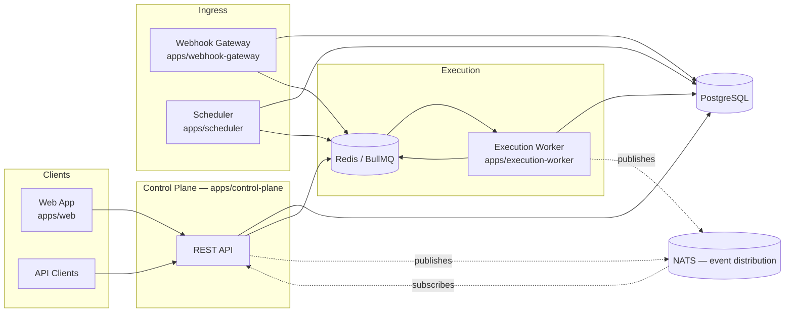
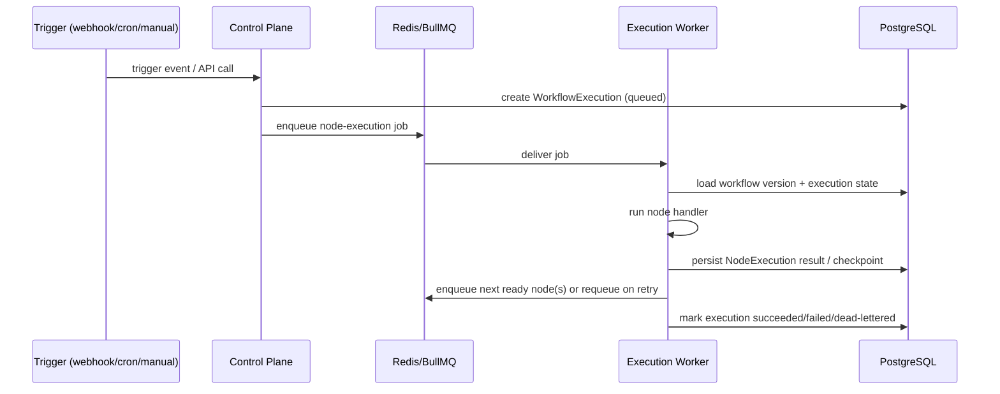

# Architecture

## Status

This document describes the target architecture for WorkflowCore. The repository is
currently at **Phase 1 (monorepo foundation)** — the services below exist as
buildable skeletons only; the behavior described here is the design target tracked
by [ROADMAP.md](./ROADMAP.md), not yet-implemented behavior claimed as done.

## System overview

WorkflowCore is split into independently deployable services that communicate
through PostgreSQL (system of record), Redis/BullMQ (job queue), and — where event
fan-out across services provides clear value — NATS.

## Services

| Service          | Package                 | Responsibility                                                                                                       |
| ---------------- | ----------------------- | -------------------------------------------------------------------------------------------------------------------- |
| Control plane    | `apps/control-plane`    | Auth, orgs, workflow CRUD, versioning, publication, execution/credential/schedule/webhook APIs                       |
| Execution worker | `apps/execution-worker` | Consumes node-execution jobs from BullMQ, runs node handlers, persists checkpoints, applies retry/error policy       |
| Scheduler        | `apps/scheduler`        | Evaluates cron/interval schedules, enqueues scheduled executions                                                     |
| Webhook gateway  | `apps/webhook-gateway`  | Terminates inbound webhook traffic, validates/signs/deduplicates, acknowledges immediately, hands off asynchronously |
| Web              | `apps/web`              | Operator UI: workflow editor (React Flow), execution history, credentials, schedules, operations                     |

## Shared packages

`workflow-definition` (schema/validation) → `execution-engine` (state machine) →
`node-sdk` (integration contract) are the core domain packages. `database` owns the
Prisma schema and generated client. `event-contracts` defines the typed
envelopes carried over BullMQ/NATS. `observability` and `security` are
cross-cutting concerns consumed by every app. `shared-types` and `ui` support the
above.

## Data flow: trigger → execution

Full execution semantics (delivery guarantees, retry classification, idempotency
requirements) are specified in
[docs/execution-semantics.md](./docs/execution-semantics.md) as they are
implemented.

## Architecture decisions

Significant, hard-to-reverse decisions are recorded under
[docs/adr/](./docs/adr/) using lightweight ADRs.
